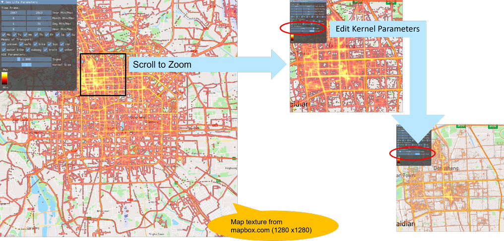

# GeoLife Visualisation (Vulkan)

A real-time visualisation of the [Microsoft Research GeoLife](https://www.microsoft.com/en-us/download/details.aspx?id=52367)
GPS trajectory data set (Beijing, 2007 – 2012). The application computes a **kernel density
estimate (KDE)** of millions of GPS points on the GPU with a **Vulkan compute shader** and
renders the result as a heat map on top of a city map. All filters are applied interactively.




## Features

- GPU-side KDE of up to ~18 million GPS points using a Vulkan compute pipeline
- Interactive filtering by year, month, day, hour, weekday and means of transport
  (walk, bike, bus, car, subway, train, …)
- Adjustable Gaussian kernel (sigma and kernel size)
- Zoom with the mouse wheel, toward the cursor position
- Logarithmic colour mapping with an on-screen colour bar
- UI built with [Dear ImGui](https://github.com/ocornut/imgui)

## Quick start

You need a C++17 compiler, CMake ≥ 3.20, Git and the Vulkan SDK (or your distribution's
Vulkan development packages). **See [BUILDING.md](BUILDING.md) for step-by-step instructions
for Windows, Linux and macOS.**

```bash
git clone https://github.com/joerg-christian/GeoLifeVis.git
cd GeoLifeVis
cmake -S . -B build -DCMAKE_BUILD_TYPE=Release
cmake --build build --config Release
```

Then run the program:

| Platform | Command |
|----------|---------|
| Windows (Visual Studio generator) | `build\Release\GeoLifeVis.exe` |
| Linux / macOS | `./build/GeoLifeVis` |

The build copies the shaders, textures and a small **sample data set** next to the
executable, so the program runs right after building. To visualise the full data set
(~18 million points), see [Getting the full data set](BUILDING.md#6-getting-the-full-geolife-data-set).

## Usage

```
GeoLifeVis [path/to/geoLifeDataSet.txt]
```

If no path is given, the program loads `geoLifeDataSet.txt` from the directory that
contains the executable.

| Control | Action |
|---------|--------|
| Mouse wheel | Zoom in/out toward the cursor |
| *Geo Life Parameters* window | Change the time frame, weekdays, means of transport and KDE parameters |
| Left mouse button release | Applies changed parameters and triggers a KDE recomputation |

## Repository layout

```
.
├── CMakeLists.txt          Cross-platform build script
├── src/                    Application source code
│   ├── main.cpp            Vulkan setup, render loop, compute dispatch
│   ├── geoLifeData.h/.cpp  Loading and preprocessing of the GeoLife data
│   └── ui.h                Dear ImGui user interface
├── shaders/                GLSL shaders (compiled to SPIR-V during the build)
│   ├── shader.comp         KDE compute shader
│   ├── shader.vert
│   └── shader.frag         Heat map colouring
├── assets/textures/        City map and colour maps
├── data/                   Sample data set (the full data set is downloaded separately)
├── docs/                   Screenshot for this README
└── third_party/            Vendored Dear ImGui and stb_image
```

GLFW and GLM are taken from your system if installed, or downloaded automatically by CMake.

## License

This project is licensed under the [MIT License](LICENSE). Third-party components keep their
own licenses (see below).

## Third-party components and credits

| Component | License |
|-----------|---------|
| [Dear ImGui](https://github.com/ocornut/imgui) (vendored, with a custom range slider) | MIT |
| [stb_image](https://github.com/nothings/stb) (vendored) | MIT / Public Domain |
| [GLFW](https://www.glfw.org/) | zlib |
| [GLM](https://github.com/g-truc/glm) | MIT |
| [GeoLife GPS Trajectories](https://www.microsoft.com/en-us/download/details.aspx?id=52367) | Microsoft Research, see the data set's terms of use |
| City map texture | © [Mapbox](https://www.mapbox.com/about/maps/) © [OpenStreetMap](https://www.openstreetmap.org/copyright) contributors |

If you use the GeoLife data in your work, please cite the papers listed on the data set's
download page.

The Vulkan code is based on the structure of the [Vulkan Tutorial](https://vulkan-tutorial.com/).
